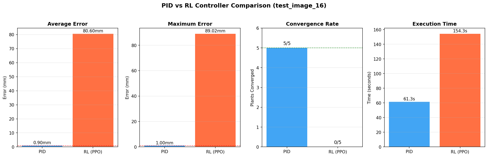
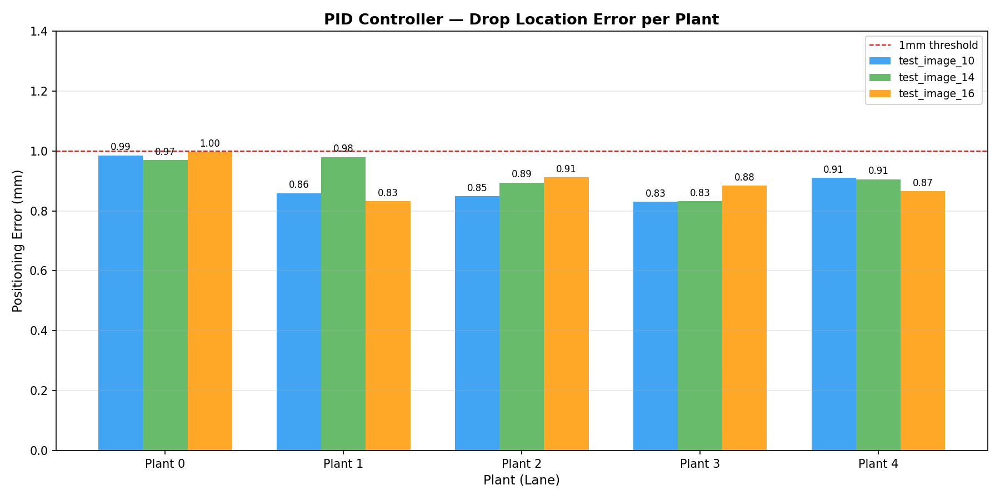
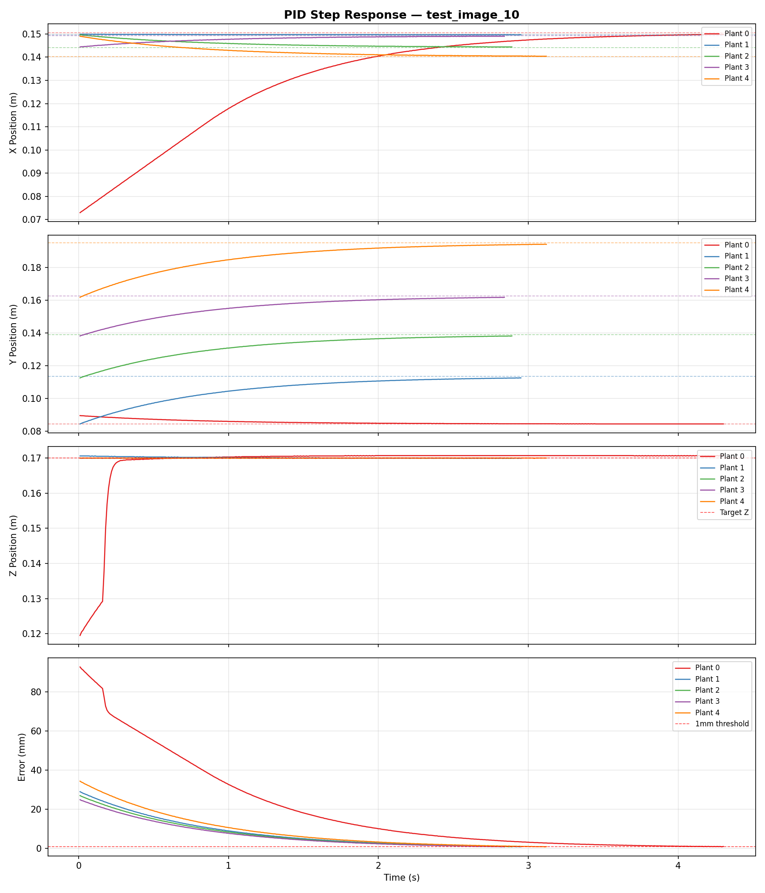

# Root Tip Detection and Robotic Inoculation

This system finds the root tip of each seedling in a petri dish image. It then drives a simulated Opentrons OT-2 pipette robot to put a drop of inoculum on every tip.

This was an individual university project at Breda University of Applied Sciences (Applied Data Science & AI, Year 2). It ran from November 2025 to January 2026 for NPEC, the Netherlands Plant Eco-phenotyping Centre.

## The problem

NPEC grows seedlings on petri dishes, five plants per plate, and inoculates them at the root tip. Doing this by hand is slow, and the pipette has to land within about a millimetre of a tip that is only visible in a high-resolution scan. The goal was to automate it end to end:

1. Locate every root tip in a raw plate image.
2. Convert each tip's position from pixels to robot coordinates.
3. Move the pipette there with less than 1 mm error.

## How it works

```
plate image (grayscale scan, 5 seedlings)
  -> crop the petri dish (adaptive threshold, morphology, contour scoring)
  -> U-Net root segmentation on 256 px patches (overlapping, flip-averaged)
  -> clean the mask (micro-closing, bridging small gaps along each root)
  -> split into 5 lanes, skeletonise, and trace each main root along a shortest path
  -> root tip in pixels -> millimetres (150 mm plate) -> robot coordinates
  -> PID controller moves the pipette to each tip and drops the inoculum
```

- **Computer vision.** A Residual Attention U-Net segments the roots.
  - It was trained on image patches with a hybrid loss: binary cross-entropy plus focal Tversky, which keeps thin, faint roots from being missed.
  - Inference stitches overlapping patches with a smooth window and averages them with flipped copies.
  - Each plant's main root is then extracted as a weighted shortest path through its skeleton. The tip is the end of that path.
- **Robot control.** Everything runs on a PyBullet digital twin of the OT-2.
  - The robot's work envelope was found by driving each axis until it stopped moving.
  - Two controllers were built and compared:
    - **PID:** one controller per axis, with an integral term only on the vertical axis to counter gravity.
    - **Reinforcement learning:** a PPO agent (Stable-Baselines3) in a custom Gymnasium environment, trained for about 3 million steps.
- **Integration.**
  - The plate is rotated by -90° in the simulation, so the image axes are swapped when tip coordinates are converted to robot space.
  - Telemetry records every control step.
  - A benchmarking script compares the PID and RL controllers on accuracy, convergence and time.

[docs/technical-notes.md](docs/technical-notes.md) has the details: loss and post-processing settings, the RL reward, the coordinate transform, and per-plate results.

## Results

| Component | Result |
|---|---|
| Root segmentation (U-Net) | Best validation F1 of **0.881** (2,058 validation patches) |
| Primary root length, course Kaggle competition | **5th of 77** on the private leaderboard (sMAPE 5.747) |
| PID controller, single target | **0.9 mm** final error |
| PPO agent, 20 random targets | **2.88 mm** mean error |
| Full system with PID (3 plates, 15 plants) | **15/15** tips reached, 0.90 mm mean and 1.00 mm max error, 63.9 s per plate |
| Full system with PPO (1 plate, 5 plants) | 0/5 tips reached, 80.6 mm mean error |

The PID controller met the 1 mm target on every plant, so it is the controller used in the integrated system. The PPO agent reached targets on its own but did not transfer to the integrated, multi-target task. The likely main reason is missing observation normalisation: the agent was trained on observations normalised with `VecNormalize`, and the standalone test (`test_rl.py`) loads those statistics, but `integration_rl.py` feeds the policy raw positions. [docs/technical-notes.md](docs/technical-notes.md#why-the-rl-agent-underperformed-in-integration) covers this and the other factors.







## My role

This was an individual project, and the work in this repository is mine: the segmentation model, the root and tip extraction, the work envelope search, both controllers, the RL environment, the integration and the benchmarking. The course provided the OT-2 digital twin and the notebook templates, such as the F1 metric and the training-curve plots. NPEC provided the plate images.

## Tech stack

Python, TensorFlow/Keras, OpenCV, scikit-image, NetworkX, SciPy, NumPy, pandas, Matplotlib, PyBullet, Gymnasium, Stable-Baselines3 (PPO), TensorBoard, imageio.

## Repository layout

```
notebooks/
  01_unet_training.ipynb          # Residual Attention U-Net training
  02_single_image_inference.ipynb # crop, patch, predict and map one plate back to full size
  03_root_tip_pipeline.ipynb      # batch inference, mask clean-up, lanes, main roots, root length, tip export
robotics/
  workspace.py                    # work envelope discovery and corner traversal
  controllers/pid.py              # discrete PID controller
  pid_controller.py               # PID step response test
  ot2_gym_wrapper.py              # Gymnasium environment for the OT-2
  train_rl.py, test_rl.py, test_wrapper.py
  integration_pid.py, integration_rl.py   # vision + control on a full plate
  telemetry.py, benchmarking.py
  project_paths.py                # shared paths
simulation/                       # put the OT-2 digital twin here (not included)
docs/                             # technical notes and result figures
```

## Data and models

The plate images, root masks, trained weights, predictions and root tip coordinates come from NPEC's data, so none of them are included. To run the code, place your own files as follows. These folders are ignored by git.

```
data/
  patches/              # prepared 256 px patches: train_images/, train_masks/, val_images/, val_masks/
  test_image.png        # one raw plate image (notebook 02)
  kaggle_test_images/   # raw plate images, test_image_XX.png (notebook 03)
  root_tip_coordinates.json   # written by notebook 03, read by the integration scripts
models/                 # unet_model_256px.h5, ppo_ot2_final.zip, vec_normalize.pkl
outputs/                # GIFs, logs and plots written by the scripts
```

Preparing the 256 px patch dataset (cropping each dish and cutting patches) isn't covered by these notebooks. Notebook 01 expects the patches to be ready.

## How to run

```bash
python -m venv .venv
source .venv/bin/activate          # Windows: .venv\Scripts\activate
pip install -r requirements.txt
```

1. **Computer vision:** run the notebooks in `notebooks/` in order. The training notebook needs a GPU in practice.
2. **Robotics:** add the OT-2 simulation to `simulation/` (see [simulation/README.md](simulation/README.md)), then run from the repository root:

   ```bash
   python robotics/workspace.py        # work envelope (opens the PyBullet window)
   python robotics/pid_controller.py   # PID step response, plot and GIF
   python robotics/integration_pid.py  # full system on one plate, headless
   python robotics/telemetry.py        # per-step telemetry plots
   python robotics/benchmarking.py     # PID vs RL comparison from the integration logs
   ```

3. **Reinforcement learning:** use a separate Python 3.10 environment:

   ```bash
   pip install -r requirements-rl.txt
   python robotics/test_wrapper.py     # sanity check of the environment
   python robotics/train_rl.py         # set TIMESTEPS; the reported agent used about 3M steps
   python robotics/test_rl.py          # 20-episode evaluation
   python robotics/integration_rl.py
   ```

Without the NPEC data and the course simulation, only the code can be inspected. Nothing can be run end to end.
