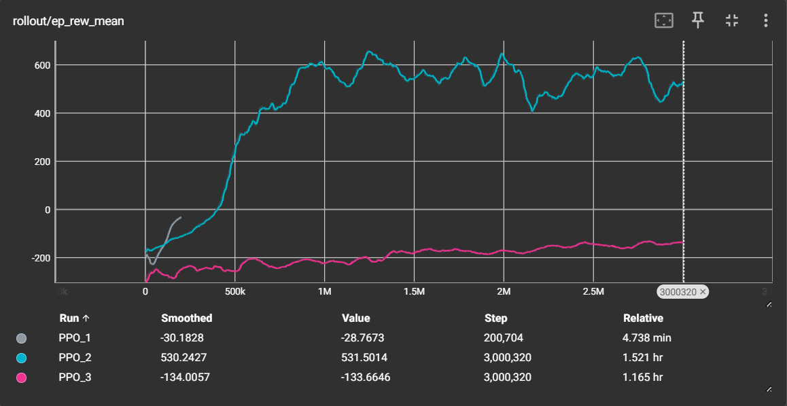
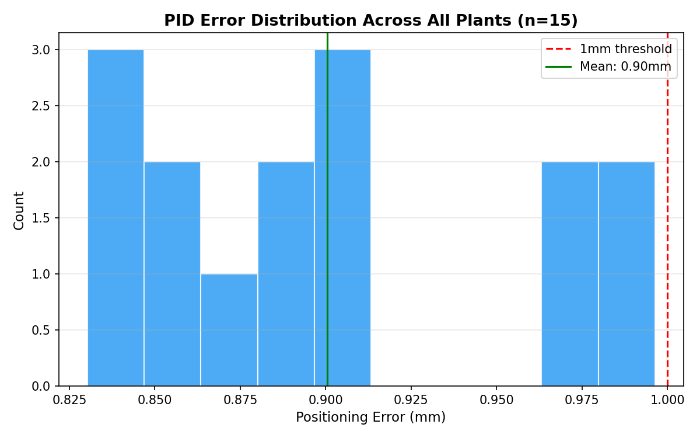
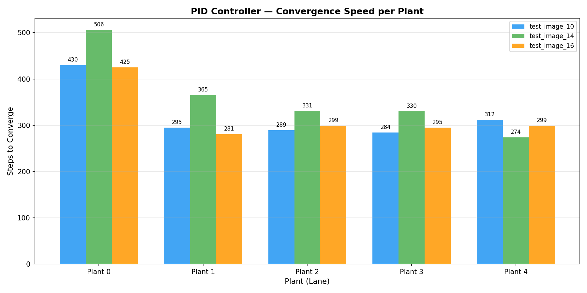
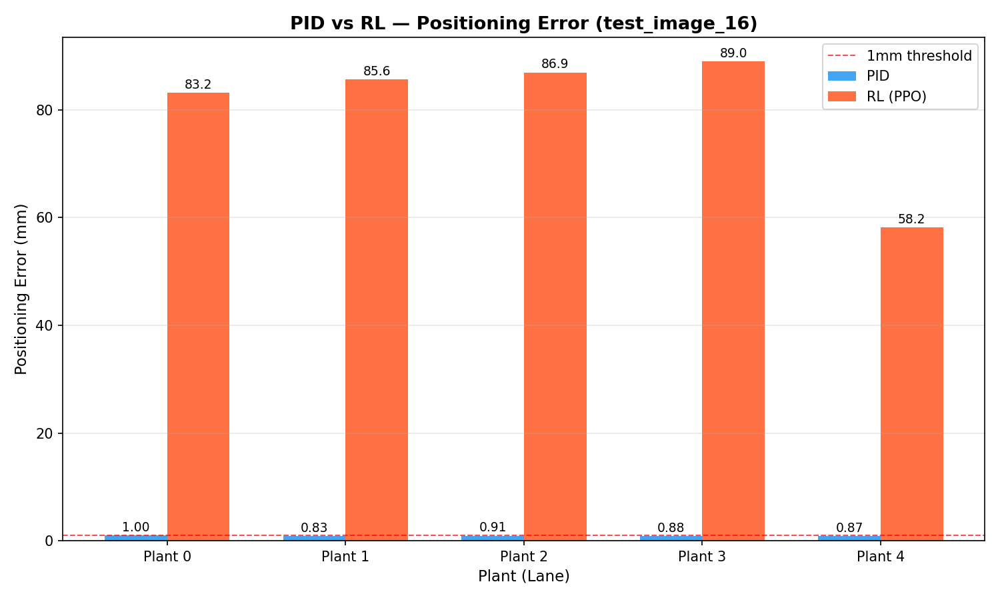

# Technical notes

## 1. Root segmentation and root tip detection

### Petri dish crop

Each raw scan (about 3000 × 4100 px) is cropped to a square around the dish:

1. Gaussian blur, adaptive mean thresholding, then morphological opening and closing.
2. Contours are scored by area minus a penalty for distance from the image centre, and the best one becomes the dish.
3. The box is refined to the inner, bright part of the plate, so the plastic rim is left out.
4. The crop is padded symmetrically to a multiple of the 256 px patch size.

### Model

A **Residual Attention U-Net** takes 256 × 256 grayscale patches as input:

- Residual blocks in the encoder and decoder keep gradients stable.
- Attention gates on the skip connections suppress background texture and condensation.

| Setting | Value |
|---|---|
| Loss | Binary cross-entropy + focal Tversky (α = 0.3, β = 0.7, γ = 4/3). This penalises missed root pixels more than false alarms. |
| Optimiser | Adam, learning rate 1e-4 |
| Augmentation | Rotation ±20°, horizontal and vertical flips, zoom 0.8–1.2, reflect fill |
| Callbacks | Early stopping on validation loss (patience 12, best weights restored); learning rate × 0.2 after 4 epochs without improvement |
| Data | 60,914 training patches, 2,058 validation patches |
| Result | Best validation F1 0.881 at epoch 14 (training stopped at epoch 26) |

### Inference

- Patches overlap with a stride of 128 px.
- Each prediction is blended with a squared Hann window, so patch borders don't show seams.
- Predictions are averaged with those of horizontally flipped patches (test-time augmentation).
- Hysteresis thresholding (low 0.05, high 0.25) keeps faint root segments that connect to confident ones.

### From mask to root tip

1. **Micro-closing:** a 4 × 4 elliptical kernel closes one-pixel breaks.
2. **Gap bridging:** skeleton endpoints on separate pieces of the same lane are joined when they are close (up to 60 px apart) and nearly vertically aligned (at most 4 px apart sideways, at least 8 px apart vertically).
3. **Lanes:** five lane boundaries are estimated from where the plants' crowns sit across all test images. Each connected component is assigned to a lane by its topmost point.
4. **Main root:** each plant's mask is skeletonised and turned into a graph. A weighted shortest path, with a penalty on horizontal steps, runs from a thick endpoint at the top of the plant to the lowest point of its skeleton. Large plants get extra rules: a central start corridor and penalties for direction changes.
5. **Measurements:**
   - The **root tip** is the last point of the main root path.
   - The **root length** is the path length, counting straight steps as 1 and diagonal steps as √2.

On the course Kaggle competition (primary root length per plant, scored by sMAPE), this pipeline placed **5th of 77** on the private leaderboard with an sMAPE of 5.747.

## 2. Robot control

### Work envelope

Constant velocity commands are applied along each axis, one direction at a time, until the pipette position stops changing. The resulting bounds:

| Axis | Range (m) |
|---|---|
| X | -0.187 to 0.253 |
| Y | -0.171 to 0.220 |
| Z | 0.169 to 0.290 |

The robot then visits all eight corners of this box.

### PID controller

There are three independent discrete PID controllers, one per axis. Each turns the position error into a velocity command, with the output clipped to ±0.3 and dt = 0.01 s.

| Axis | Kp | Ki | Kd | Reason |
|---|---|---|---|---|
| X | 4.0 | 0.0 | 1.0 | PD is enough; no constant external force |
| Y | 4.0 | 0.0 | 1.0 | PD is enough; no constant external force |
| Z | 5.0 | 0.5 | 1.2 | The integral term removes the steady-state error caused by gravity |

The gains were tuned in this order:

1. Increase P until the response is fast.
2. Add D to damp the resulting oscillation.
3. Add I on Z only.

A target counts as reached when the error stays under 1 mm for 10 consecutive steps. On the test target, the final error was **0.9 mm**.

### Reinforcement learning

`ot2_gym_wrapper.py` wraps the simulation as a Gymnasium environment.

**Environment**

| Item | Definition |
|---|---|
| Observation | Pipette position and target position (6 values) |
| Action | Velocity in X, Y and Z, in [-1, 1], scaled by 0.08. Each action runs 10 physics steps. |
| Reward | Minus the distance, plus 2 × the progress made this step, minus a small penalty on action size, plus 10 when the error is under 1 mm |
| Episode | Random target and random start position; ends on success or after 1,000 steps |

**Training**

| Item | Setting |
|---|---|
| Algorithm | PPO (Stable-Baselines3), MLP policy with two layers of 64 units |
| Hyperparameters | Learning rate 3e-4, n_steps 2048, batch size 64, γ 0.99, clip range 0.2 |
| Normalisation | `VecNormalize` on observations and rewards |
| Run | About 3M steps |
| Speed | Removing the simulation's per-step `sleep` raised throughput from about 24 to about 800 steps per second, so the run took about 1.5 hours instead of a projected 34 |

**Result:** a mean final error of **2.88 mm** over 20 random test episodes. That is under the brief's 5 mm threshold but above the 1 mm one. The agent learned a smooth, overdamped approach with almost no overshoot.



## 3. Integration

### Pixel to robot coordinates

```python
# 1. original image -> plate-relative pixels (bbox from the dish crop)
plate_px_x = tip_x - bbox_x
plate_px_y = tip_y - bbox_y

# 2. pixels -> millimetres (the plate is 150 mm wide)
scale = 150.0 / bbox_side            # about 0.0549 mm per pixel for a 2734 px crop
mm_x, mm_y = plate_px_x * scale, plate_px_y * scale

# 3. millimetres -> robot coordinates; the plate is rotated -90 degrees in the simulation
robot_x = 0.10775 + mm_y / 1000      # image Y -> robot X
robot_y = 0.062 + mm_x / 1000        # image X -> robot Y
robot_z = 0.17                       # lowest reachable pipette height
```

The pipette can't go lower than Z = 0.17 m, so the droplet falls to the plate surface at Z = 0.057 m.

### Results per plate (PID)

| Plate | Mean error (mm) | Max error (mm) | Converged | Time (s) |
|---|---|---|---|---|
| test_image_10 | 0.89 | 0.99 | 5/5 | 62.5 |
| test_image_14 | 0.92 | 0.98 | 5/5 | 68.1 |
| test_image_16 | 0.90 | 1.00 | 5/5 | 61.3 |

**Over all 15 plants:**

| Metric | Value |
|---|---|
| Mean error | 0.90 mm (standard deviation 0.05 mm) |
| Error range | 0.83 to 1.00 mm |
| Steps to converge | 331 on average (274 to 506) |

The first plant on each plate takes the most steps, because the pipette starts from its home position.





### Time per plate

| Stage | Time |
|---|---|
| Segmentation with test-time augmentation | about 5.7 s |
| Mask post-processing | about 1 s |
| Lanes, skeletons and root extraction | about 2 s |
| Coordinate transform | under 1 ms |
| PID control for 5 plants | about 64 s |
| **Total** | **about 73 s** |

### PID vs RL on the same plate (test_image_16)

| Metric | PID | RL (PPO) |
|---|---|---|
| Mean error | 0.90 mm | 80.60 mm |
| Max error | 1.00 mm | 89.02 mm |
| Converged | 5/5 | 0/5 |
| Time | 61.3 s | 154.3 s |



### Why the RL agent underperformed in integration

- **Missing observation normalisation (most likely).** Training wrapped the environment in `VecNormalize`, so the policy learned from normalised observations. `test_rl.py` loads the saved statistics, which is why the standalone test reached 2.88 mm. `integration_rl.py` loads only the policy and feeds it raw pipette and target positions, which are on a different scale from anything it saw in training. Loading `vec_normalize.pkl` and normalising each observation the same way is the first fix to try.

Other factors that may contribute:

- **Edge of the training range.** The integration targets sit at Z = 0.17 m, the very bottom of the Z range used in training (0.169 to 0.290 m).
- **No resets.** Training used single-target episodes with random resets. In integration, the agent moves from tip to tip without a reset.
- **No integral action.** Nothing in the policy explicitly counters the steady pull of gravity on the Z axis.
- **Reward shape.** The dense reward rewards getting close, but barely distinguishes 1 mm from 5 mm.

PID was chosen for the integrated system. It is more accurate, always converges, is faster, and is easier to interpret and debug.

### Ideas for improvement

- Let the pipette reach closer to the plate, so the droplet falls a shorter distance than 113 mm.
- Use higher gains while far from the target and switch to finer gains near it. This would speed up the first plant on each plate.
- Run inference without test-time augmentation when speed matters more than the last bit of accuracy.
- Detect root tips with a dedicated model, or use curvature analysis, for curved or overlapping roots.
- Calibrate each plate with fiducial markers instead of a fixed plate origin.
- Visit plants in nearest-neighbour order.
- For RL, try any of these:
  - Fine-tune at Z = 0.17 m.
  - Train on sequences of several targets.
  - Use a curriculum that tightens the success threshold.
  - Let RL handle the coarse approach and PID the final millimetres.
